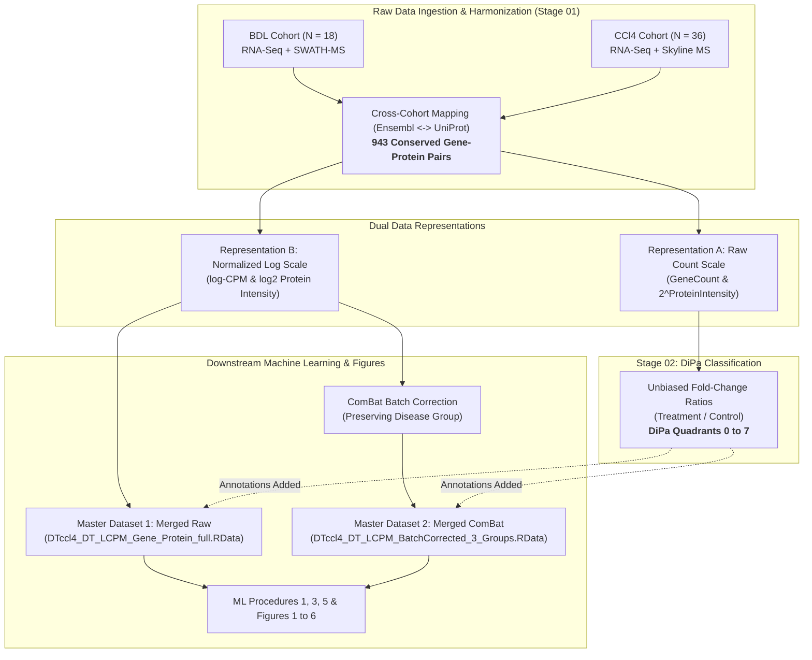

# Discrete-coupling-regimes-govern-mRNA-protein-relationships-and-predictability

[](LICENSE)
[](https://www.r-project.org/)
[](https://bioconductor.org/packages/release/bioc/html/sva.html)
[](02_DiPa_Classification_and_Analysis/)
[](https://www.nature.com/ncomms/)

---

## 📖 Scientific Overview

This repository provides the complete, self-contained, reproducible codebase and analysis pipelines for our study on **machine learning-driven proteome modeling across cholestatic and toxic liver fibrosis**.

By integrating parallel transcriptomic (RNA-Seq) and quantitative proteomic (LC-MS/MS) measurements from:
1. **Biliary Obstruction Model (BDL):** $n = 18$ mice (Sham, BDL, BDL + AS0369 ASBT inhibitor).
2. **Toxic Necrosis Model ($\text{CCl}_4$):** $n = 36$ mice (Mineral oil vehicle controls and $\text{CCl}_4$ across 0, 2, 6, and 12 months).
3. **Conserved Harmonized Manifold:** **943** core matched gene–protein pairs analyzed across $N = 54$ animals.

We establish the **Differentiation Pattern (DiPa)** co-regulation taxonomy and benchmark four distinct machine learning architectures across **intra-cohort**, **cross-cohort blind transfer**, and **merged-cohort** evaluation frameworks.

---

## 🧭 Reviewer's Guide to Datasets & Multi-Omics Representations

To ensure full transparency and avoid any ambiguity during peer review, this section provides a **clear, simple breakdown** of how datasets are organized, why two distinct data representations exist, and how samples are split across analyses.



### 🔹 1. Why Two Data Representations? (Raw Counts vs. Normalized Log)

| Feature | Representation A: Raw Counts (`count`) | Representation B: Normalized Log (`LCPM`) |
| :--- | :--- | :--- |
| **Units** | Linear RNA counts (`GeneCount`) & natural linear protein intensity ($2^{\text{ProteinIntensity}}$) | edgeR TMM normalized $\log_2\text{CPM}$ & MSstats $\log_2$ protein intensity |
| **Purpose** | **Strictly for DiPa Fold-Change Classification (Stage 02)** | **All Machine Learning Models (Stage 03) & Figures (Stage 04)** |
| **Mathematical Rationale** | True fold-changes ($\text{Mean}_{\text{treat}} / \text{Mean}_{\text{ctrl}}$) require linear scale to prevent compression artifacts caused by log-scale averaging. | Machine learning regression (Lasso, RF, GAMs) and ComBat batch adjustment require continuous, variance-stabilized distributions. |
| **Files in Repository** | `raw_data/Data_count_*`, `Data_ccl4_count_*` | `processed_data/DT*_LCPM_*`, `Master Datasets 1 & 2` |

---

### 🔹 2. Master Datasets & Data Dictionary

All downstream machine learning procedures and figure generation scripts load directly from `01_Data_Preprocessing_Harmonization_and_Batch_Correction/processed_data/`:

| Dataset File | Description | Cohort | Dimensions | Primary Use |
| :--- | :--- | :---: | :---: | :--- |
| **`DTccl4_DT_LCPM_Gene_Protein_full.RData`** | **Master Dataset 1 (Raw Merged)** | Both ($N=54$) | 50,922 rows $\times$ 19 cols | Baseline / uncorrected multi-omics benchmark |
| **`DTccl4_DT_LCPM_BatchCorrected_3_Groups.RData`** | **Master Dataset 2 (ComBat Merged)** | Both ($N=54$) | 50,922 rows $\times$ 21 cols | **Primary dataset for ML Procedures 1, 3, 5 & Figures 1–6** |
| `DT_LCPM_filtered_final_Gene_Protein_full.RData` | BDL Cohort (Raw $\log\text{CPM}$) | BDL ($n=18$) | 16,974 rows $\times$ 17 cols | Intra-cohort BDL modeling & diagnostics |
| `DT_LCPM_filtered_final_Gene_Protein_full_Batch.RData` | BDL Cohort (ComBat Corrected) | BDL ($n=18$) | 16,974 rows $\times$ 18 cols | Intra-cohort BDL batch-corrected modeling |
| `DTccl4_filtered_final_Gene_Protein_full.RData` | $\text{CCl}_4$ Cohort (Raw $\log\text{CPM}$) | $\text{CCl}_4$ ($n=36$) | 33,948 rows $\times$ 17 cols | Intra-cohort $\text{CCl}_4$ modeling & diagnostics |
| `DTccl4_filtered_final_Gene_Protein_full_Batch.RData` | $\text{CCl}_4$ Cohort (ComBat Corrected) | $\text{CCl}_4$ ($n=36$) | 33,948 rows $\times$ 18 cols | Intra-cohort $\text{CCl}_4$ batch-corrected modeling |
| `Supplementary_Table_1_RNA_Protein_Pairs.xlsx` | Journal Wide Matrix | Both ($N=54$) | 54 mice $\times$ 3,775 cols | Complete publication multi-omics table (0 NAs) |

---

### 🔹 3. Cohort Sample Sizes: Full Cohorts vs. Subset Cohorts

| Cohort Level | BDL Cohort ($n$) | $\text{CCl}_4$ Cohort ($n$) | Merged ($N$) | Description & Composition |
| :--- | :---: | :---: | :---: | :--- |
| **Full Cohort** | **$n = 18$** | **$n = 36$** | **$N = 54$** | **All experimental animals.**<br/>• BDL: Sham ($n=6$), BDL untreated ($n=6$), BDL + ASBTi ($n=6$).<br/>• $\text{CCl}_4$: Oil controls ($n=18$) and $\text{CCl}_4$ ($n=18$) across 0, 2, 6, 12 months.<br/>*(Note: In $\text{CCl}_4$, 31 mice have paired LC-MS/MS proteomics; 5 mice lack proteomics due to sample availability).* |
| **Subset Cohort**<br/>(`_sub` in Proc 1 & 5,<br/>`_24` in Proc 3) | **$n = 12$** | **$n = 12$** | **$N = 24$** | **Two-condition contrast (Healthy Baseline vs. Severe Fibrosis).**<br/>• BDL Subset ($n=12$): Sham control ($n=6$) vs. BDL untreated ($n=6$) [excludes ASBT inhibitor].<br/>• $\text{CCl}_4$ Subset ($n=12$): Month 0 Oil baseline ($n=6$) vs. Month 12 $\text{CCl}_4$ chronic fibrosis ($n=6$).<br/>• Merged Subset ($N=24$): Exactly combines the 12 BDL + 12 $\text{CCl}_4$ subset mice. |

---

### 🔹 4. Differentiation Pattern (DiPa) Co-Regulation Taxonomy

| DiPa Cluster | Biological Co-Regulation Regime | $\text{CCl}_4$ Pairs ($N$) | BDL Pairs ($N$) | Conserved Target Evaluated Core ($N$) |
| :---: | :--- | :---: | :---: | :---: |
| **0 / 8** | Baseline / Neutral (non-responsive) | 342 | 386 | **202** (DiPa 0/8) |
| **1** | Synergistic Co-Upregulation (Up-Up) | 94 | 146 | **118** (DiPa 1–2 combined intersect) |
| **2** | Synergistic Co-Downregulation (Down-Down) | 88 | 137 | |
| **3** | Protein Upregulation Only (Post-transcriptional accumulation) | 57 | 56 | **67** (DiPa 3–4 combined intersect) |
| **4** | Protein Downregulation Only (Post-transcriptional degradation) | 209 | 126 | |
| **5** | RNA Upregulation Only (Translational buffering) | 113 | 68 | **23** (DiPa 5–6 combined intersect) |
| **6** | RNA Downregulation Only (Protein persistence) | 14 | 17 | |
| **7** | Discordant / Inverted Regulation | 26 | 7 | — (excluded from target evaluation) |
| **Total** | **All Analyzed Pairs** | **943** | **943** | **410** |

> [!NOTE]
> **Data Harmonization Note:** Across all datasets (`raw_data/` and `processed_data/`), the canonical DiPa assignments are strictly synchronized: Cluster 7 contains exactly **26** pairs in $\text{CCl}_4$ and **7** pairs in BDL. Exactly **410** pairs form the conserved target evaluation core ($118 + 67 + 23 + 202 = 410$) shared between both etiologies for cross-cohort and merged machine learning benchmarks.

---

## 🎯 Target Protein Stratification vs. Candidate Covariate Pool

### 🔹 Target Response Proteins to Predict:
Models evaluate prediction accuracy on target protein abundances stratified by DiPa co-regulation quadrants:
* **DiPa 1–2 (Concordant):** **118** conserved pairs ($74 + 44$).
* **DiPa 3–4 (Protein-Only):** **67** conserved pairs ($31 + 36$).
* **DiPa 5–6 (RNA-Only / Buffering):** **23** conserved pairs ($18 + 5$).
* **DiPa 0 / 8 (Neutral Core):** **202** conserved pairs.
* **Total Conserved Evaluation Core:** $118 + 67 + 23 + 202 = \mathbf{410}$ pairs.

### 🔹 Candidate Covariate Search Space (Full 943 Proteome):
While prediction targets are evaluated within specific DiPa quadrants, the feature selection algorithms in **RF + Lasso**, **RF + RF**, and **Mastery 50** search across the **entire proteome of 943 gene–protein pairs** to identify optimal trans-regulatory covariates.

---

## 📂 Repository Architecture

```text
Protein_Modeling_Consortium_GitHub/
│
├── 📁 01_Data_Preprocessing_Harmonization_and_Batch_Correction/ ──► Raw preprocessing, mapping & ComBat batch correction
├── 📁 02_DiPa_Classification_and_Analysis/        ──► Raw count 2D DiPa quadrant classification (thresh = 0.5)
│
├── 📁 03_Machine_Learning_Procedures/
│   ├── 📁 Procedure_1_Cross_Cohort/               ──► Cross-cohort blind transfer (Train BDL <-> Test CCl4) (N = 12 subset cohorts)
│   ├── 📁 Procedure_3_Merged_Cohort/              ──► Merged cohort cross-validation (N = 24 subset cohort)
│   ├── 📁 Procedure_5_Intra_Cohort/               ──► Intra-cohort LOOCV (Intra-BDL & Intra-CCl4) (N = 12 subset cohorts)
│   └── 📁 Shared_Modeling_Functions/              ──► Core modeling engine functions
│
└── 📁 04_Figure_Generation/
    ├── 📁 Figure_01/ to Figure_06/                ──► Main Figures (Vector PDFs, Master Scripts & READMEs)
    ├── 📁 Supplementary_Figure_01/ to 05/         ──► Supplementary Figures (Biological validations, Volcano, Kinases, Sensitivity)
    └── 📁 Supplementary_Figure_06/                ──► Supplementary Figure 6 & Supplementary Table 5: Gaussian Mixture Models & BIC
```

---

## 📊 Supplementary Figure 6 & Supplementary Table 5
Located in `04_Figure_Generation/Supplementary_Figure_06/`:
* **Statistical Objective:** Rigorous data-driven validation of DiPa coupling regimes independent of threshold boundaries, fitting constrained bivariate Gaussian Mixture Models ($K \in \{1, 2, 3\}$, elongation factors $c \in \{1.3, 1.5, 2.0, 2.5, 4.0\}$) via an Expectation-Maximization (EM) algorithm to all $N = 943$ matched pairs.
* **Panel A (BDL):** Optimal 2-component mixture ($K = 2, c = 1.3$, $\Delta\text{BIC} = -304.8$), resolving canonical diagonal coupling ($90.9\%$) and vertical protein-dominant decoupling ($9.1\%$).
* **Panel B ($\text{CCl}_4$):** Optimal 3-component mixture ($K = 3, c = 1.3$, $\Delta\text{BIC} = -222.3$), resolving diagonal coupling ($61.6\%$), vertical decoupling ($30.2\%$), and horizontal transcriptomic buffering ($8.2\%$).
* **Panel C (Model Selection Bar Chart):** Systematic comparison of all 22 candidate models ranked by increasing absolute BIC independently per etiology using dynamic facet reordering (`scale_x_reordered`).
* **Supplementary Table 5:** Full statistical table available in CSV (`Supplementary_Table_5_Mixture_Models.csv`), Standalone Landscape PDF (`Supplementary_Table_5_Standalone.pdf`), and LaTeX source.

---

## 🛠️ Required R Packages & Installation

To install all required dependencies:

```r
install.packages(c(
  "data.table", "ggplot2", "cowplot", "magick", "pdftools",
  "glmnet", "randomForest", "mgcv", "stringr", "pbapply", "pheatmap"
))

if (!requireNamespace("BiocManager", quietly = TRUE))
    install.packages("BiocManager")
BiocManager::install(c("sva", "limma", "edgeR", "DESeq2", "MSstats"))
```

---

